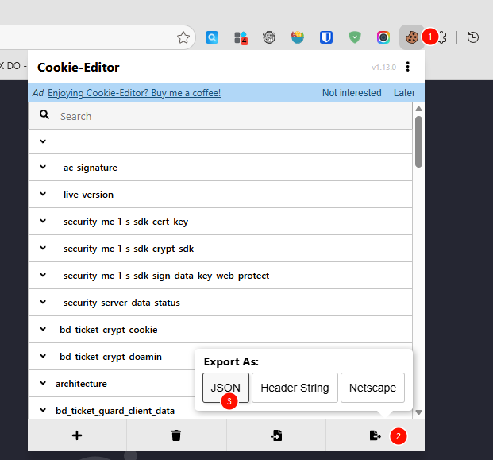

<h1 align="center">🔥 Douyin Auto Spark</h1>

<p align="center">
  <strong>抖音聊天续火脚本 · Playwright 自动化 · 本地运行</strong>
</p>

<div align="center">
  
</div>
<br>

<div align="center">
  <a href="https://github.com/bling-yshs/douyin-auto-spark/stargazers"></a>
  <a href="https://github.com/bling-yshs/douyin-auto-spark/blob/main/LICENSE"></a>
</div>
<br>

## ✨ 项目简介

本项目是一个基于 **Playwright + TypeScript** 的抖音自动续火脚本。它会携带你配置的抖音 Cookie 打开聊天页，按配置的会话名称依次定位聊天对象，并从 `assets/yiyan.json` 中随机挑选一言发送出去。GitHub Actions 运行方式已不可用，本项目目前只支持本地运行。

## 🚀 功能特性

- 🎭 **Cookie 登录** - 通过 `DOUYIN_COOKIE` 注入抖音登录态，无需在脚本中输入账号密码
- 🎯 **多会话发送** - 通过 `DOUYIN_TARGET_NAMES` 配置多个聊天对象
- 👥 **多账号续火** - 可通过 `DOUYIN_ACCOUNTS` 为多个账号分别配置 Cookie、聊天对象和消息模板
- 💬 **随机一言** - 每次从 `assets/yiyan.json` 随机挑选一条 `hitokoto`，默认以 `——「出处」` 的格式附上来源
- 🤖 **本地定时续火** - 配合 Windows 任务计划程序每天自动续火，失败时邮件告警（见 `scripts/run-daily.ps1`）

## 🧰 准备工作

在配置本地 `.env` 之前，需要先准备抖音 Cookie 和要发送消息的会话名称。

### 1️⃣ 获取抖音 Cookie

1. 使用 Chrome/Edge 打开 [Cookie-Editor 插件页面](https://chromewebstore.google.com/detail/cookie-editor/hlkenndednhfkekhgcdicdfddnkalmdm)，安装 Cookie-Editor。 [（Edge点我）](https://microsoftedge.microsoft.com/addons/detail/cookieeditor/neaplmfkghagebokkhpjpoebhdledlfi)

2. 打开 [抖音聊天页](https://www.douyin.com/chat)，并登录你的抖音账号。

3. 登录成功后，点击浏览器右上角的 Cookie-Editor 插件图标。

4. 点击 `Export`，选择 `JSON`，复制导出的完整数组内容。

   

导出的内容大概长这样：

```json
[
  {
    "domain": ".douyin.com",
    "expirationDate": 1800175766.87008,
    "hostOnly": false,
    "httpOnly": false,
    "name": "UIFID",
    "path": "/",
    "sameSite": "no_restriction",
    "secure": true,
    "session": false,
    "storeId": null,
    "value": "替换成真实 Cookie 值"
  }
]
```

后面配置 `DOUYIN_COOKIE` 时，需要把整个 JSON 数组作为 `.env` 中 `DOUYIN_COOKIE` 的值填进去。

## 💻 运行方式

GitHub Actions 运行方式已不可用，本项目目前只支持本地运行。

### 1️⃣ 安装依赖

本地调试需要 Node.js 和 pnpm

```bash
pnpm install
```

### 2️⃣ 配置环境变量

复制 `.env.example` 为 `.env`，并按实际情况修改：

```bash
cp .env.example .env
```

核心配置如下：

| 变量 | 必填 | 默认值 | 说明 |
|:---|:---:|:---:|:---|
| `DOUYIN_COOKIE` | ✅ | - | Cookie-Editor 导出的完整 Cookie JSON 数组 |
| `DOUYIN_TARGET_NAMES` | ✅ | - | 要发送消息的好友名称 JSON 数组 |
| `DOUYIN_ACCOUNTS` | ❌ | - | 多账号配置，配置后会无视单账号配置，详情见下方「👥 多账号配置」 |
| `YIYAN_INCLUDE_SOURCE` | ❌ | `true` | 是否携带一言出处，设置为 `false` 时只发送一言正文 |
| `SPARK_MESSAGE_TEMPLATE` | ❌ | - | 自定义火花消息模板，见下方「自定义消息模板」 |
| `PLAYWRIGHT_BROWSER_PATH` | ❌ | - | 本机 Chrome / Chromium / Edge 可执行文件路径，不填则使用 Playwright 默认浏览器 |
| `PLAYWRIGHT_HEADLESS` | ❌ | `true` | 是否使用无头模式 |
| `AUTO_CLOSE` | ❌ | `true` | 发送完成后是否自动关闭浏览器 |

### 3️⃣ 启动项目

```bash
pnpm dev
```

脚本会打开 `https://www.douyin.com/chat`，依次定位配置中的好友并发送随机一言。

### 4️⃣ 每日定时运行（可选）

Windows 下可配合系统自带的「任务计划程序」每天自动续火，项目已提供封装脚本 `scripts/run-daily.ps1`，它会：

1. 强制无头模式运行续火脚本，控制台输出追加到 `artifacts/logs/<日期>.log`
2. 执行失败或超时（默认 30 分钟）时，通过 SMTP 发送告警邮件并附失败截图
3. 最近一次执行结果写入 `artifacts/LAST_RESULT.txt`
4. 自动清理 30 天前的旧日志

在「任务计划程序」中新建任务，触发器设为每天固定时间，操作填写：

```text
程序/脚本：powershell
参数：-NoProfile -ExecutionPolicy Bypass -File <项目根目录>\scripts\run-daily.ps1
```

也可以跳过界面，用 PowerShell「以管理员身份运行」一键注册（先把 `$root` 换成你的项目根目录）：

```powershell
$root = 'd:\project\DustIkun_huohua'

$action = New-ScheduledTaskAction `
  -Execute 'C:\Windows\System32\WindowsPowerShell\v1.0\powershell.exe' `
  -Argument ('-NoProfile -ExecutionPolicy Bypass -File "{0}\scripts\run-daily.ps1"' -f $root) `
  -WorkingDirectory $root

$trigger = New-ScheduledTaskTrigger -Daily -At '09:00' -RandomDelay (New-TimeSpan -Minutes 2)

$settings = New-ScheduledTaskSettingsSet `
  -StartWhenAvailable `
  -AllowStartIfOnBatteries `
  -DontStopIfGoingOnBatteries `
  -ExecutionTimeLimit (New-TimeSpan -Hours 2) `
  -MultipleInstances IgnoreNew

Register-ScheduledTask -TaskName '抖音续火-每日' `
  -Action $action -Trigger $trigger -Settings $settings `
  -Description '每天无头续火，失败时邮件告警'
```

注册完建议立刻跑一次验证，而不是等第二天：

```powershell
Start-ScheduledTask -TaskName '抖音续火-每日'
Get-ScheduledTaskInfo -TaskName '抖音续火-每日' | Format-List LastRunTime, LastTaskResult, NextRunTime
```

`LastTaskResult` 为 `0x0` 表示成功，`0x41301` 表示还在运行。任务名已存在时注册会报错，先执行 `Unregister-ScheduledTask -TaskName '抖音续火-每日' -Confirm:$false`，或给 `Register-ScheduledTask` 追加 `-Force`。

注册出来的任务等价于「只在用户登录时运行」，触发时间点 Windows 账号需处于登录状态（锁屏不影响）。Playwright 的浏览器装在 `%LOCALAPPDATA%\ms-playwright` 下、按用户隔离，换账户或用 SYSTEM 运行会找不到浏览器。

脚本参数：`-TestMail` 只发一封测试邮件验证通知通道；`-TimeoutMinutes` 调整超时分钟数；`-KeepLogDays` 调整日志保留天数（0 表示不清理）。

### 5️⃣ 失败邮件通知（可选）

在 `.env` 中配置以下变量后，定时脚本检测到续火失败会自动发告警邮件，并附带失败截图：

| 变量 | 必填 | 默认值 | 说明 |
|:---|:---:|:---:|:---|
| `MAIL_ADDRESS` | ✅ | - | SMTP 发件邮箱地址 |
| `MAIL_TO` | ❌ | `MAIL_ADDRESS` | 告警邮件收件地址 |
| `MAIL_USERNAME` | ❌ | `MAIL_ADDRESS` | SMTP 登录账号 |
| `MAIL_PASSWORD` | ✅ | - | SMTP 授权码或密码；QQ 邮箱请填写授权码 |
| `MAIL_HOST` | ❌ | `smtp.qq.com` | SMTP 服务器地址 |
| `MAIL_PORT` | ❌ | `587` | SMTP 端口，使用 STARTTLS |

三个核心变量（`MAIL_ADDRESS`、`MAIL_USERNAME`、`MAIL_PASSWORD`）配置齐全后邮件通知才会生效；只跑 `pnpm dev` 手动续火时不需要配置这些变量。

### 6️⃣ 先手动验证一次

定时任务跑起来之前，建议先用 `pnpm dev` 手动跑一次确认 Cookie 和好友名称配置无误，再启用任务计划程序。

## 👥 多账号配置

需要为多个抖音账号续火时，将下面的 JSON 保存为本地 `.env` 中的环境变量 `DOUYIN_ACCOUNTS`。每个账号的 `cookie` 都要替换成 Cookie-Editor 导出的完整数组。

```json
[
  {
    "name": "账号1",
    "cookie": [
      {
        "domain": ".douyin.com",
        "expirationDate": 1800175766.87008,
        "hostOnly": false,
        "httpOnly": false,
        "name": "UIFID",
        "path": "/",
        "sameSite": "no_restriction",
        "secure": true,
        "session": false,
        "storeId": null,
        "value": "账号1的真实 Cookie 值"
      }
    ],
    "targetNames": ["好友A", "好友B"]
  },
  {
    "name": "账号2",
    "cookie": [
      {
        "domain": ".douyin.com",
        "expirationDate": 1800175766.87008,
        "hostOnly": false,
        "httpOnly": false,
        "name": "UIFID",
        "path": "/",
        "sameSite": "no_restriction",
        "secure": true,
        "session": false,
        "storeId": null,
        "value": "账号2的真实 Cookie 值"
      }
    ],
    "targetNames": ["好友C"],
    "messageTemplate": "{{friend}}，{{account}} 今天来续火啦\\n{{date}} {{weekday}}"
  }
]
```

每个账号对象支持的字段：

| 字段 | 必填 | 说明 |
|:---|:---:|:---|
| `name` | ✅ | 账号标识，用于日志、错误提示、失败截图和 `{{account}}` 占位符；不同账号不能重名 |
| `cookie` | ✅ | Cookie-Editor 为这个账号导出的完整 JSON 数组 |
| `targetNames` | ✅ | 这个账号需要发送消息的好友名称数组，建议使用抖音备注名 |
| `messageTemplate` | ❌ | 账号独立模板；JSON 字符串中的换行写成 `\n`，未配置时继承全局模板 |

配置 `DOUYIN_ACCOUNTS` 后会优先使用多账号配置。脚本会依次运行各账号，单个账号失败后继续执行其余账号，最后统一报告失败。

## ✉️ 自定义消息模板

配置 `SPARK_MESSAGE_TEMPLATE` 可定义所有账号共用的默认消息内容；账号对象中的 `messageTemplate` 可以覆盖它：

```dotenv
SPARK_MESSAGE_TEMPLATE={{friend}}，今天的火花到账啦🔥\n{{yiyan}}\n——「{{from}}」\n{{date}} {{weekday}}
```

支持的占位符：

| 占位符 | 说明 |
|:---|:---|
| `{{account}}` | 当前账号的配置名称 |
| `{{friend}}` | 好友名 |
| `{{yiyan}}` | 一言正文 |
| `{{from}}` | 一言出处 |
| `{{date}}` | 日期 `yyyy-MM-dd` |
| `{{time}}` | 时间 `HH:mm` |
| `{{weekday}}` | 星期几 |

## 🔨 开发命令

```bash
# 启动脚本
pnpm dev

# TypeScript 类型检查
pnpm typecheck

# 代码格式化
pnpm format
```

## 📂 项目结构

```text
douyin-auto-spark/
├── scripts/
│   └── run-daily.ps1           # ⏰ 本地每日定时执行 + 失败邮件通知
├── assets/
│   ├── readme/                 # 🖼️ README 资源
│   └── yiyan.json              # 📚 随机消息数据源
├── src/
│   ├── main.ts                 # 🎭 Playwright 自动化入口
│   └── types/
│       ├── douyin-cookie.ts    # 🍪 抖音 Cookie 类型
│       └── yiyan.ts            # 💬 一言数据类型
├── .env.example                # ⚙️ 环境变量示例
├── .gitignore                  # 🙈 Git 忽略规则
├── .oxfmtrc.jsonc              # 🎨 oxfmt 配置
├── .oxlintrc.jsonc             # 🔍 oxlint 配置
├── LICENSE                     # 📄 GPL v3.0 许可证
├── pnpm-lock.yaml              # 🔒 pnpm 依赖锁文件
├── tsconfig.json               # 🧩 TypeScript 配置
└── package.json                # 📦 项目依赖与脚本
```

## 🛠️ 本地环境

|  环境   | 版本要求 |
|:-------:|:--------:|
| Node.js |   20+    |
|  pnpm   |    11    |

## 🔗 主要依赖

| 依赖 | 用途 |
|:---|:---|
| `playwright` | 自动打开浏览器、注入 Cookie、定位会话并发送消息 |
| `dotenv` | 读取本地 `.env` 配置 |
| `tsx` | 本地通过 `pnpm dev` 运行 TypeScript 脚本 |
| `typescript` | 执行 `pnpm typecheck` 类型检查 |
| `oxlint` / `oxfmt` | 代码检查与格式化 |

## 📄 许可证

本项目采用 [GPL v3.0](LICENSE) 开源许可证。
